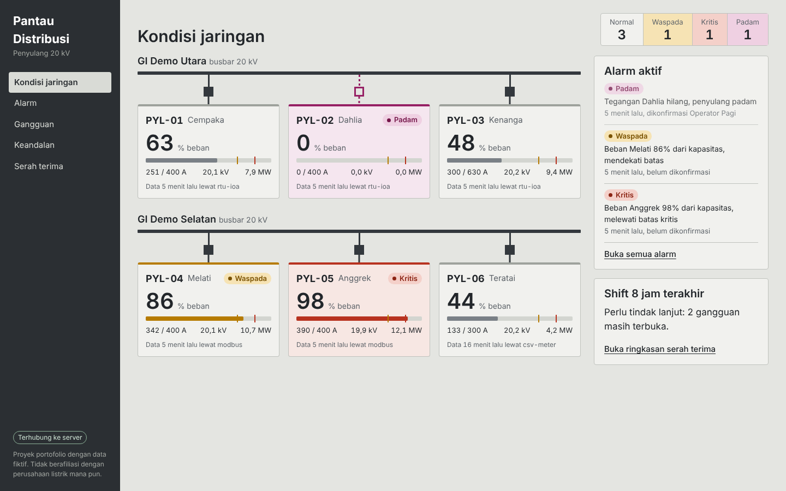
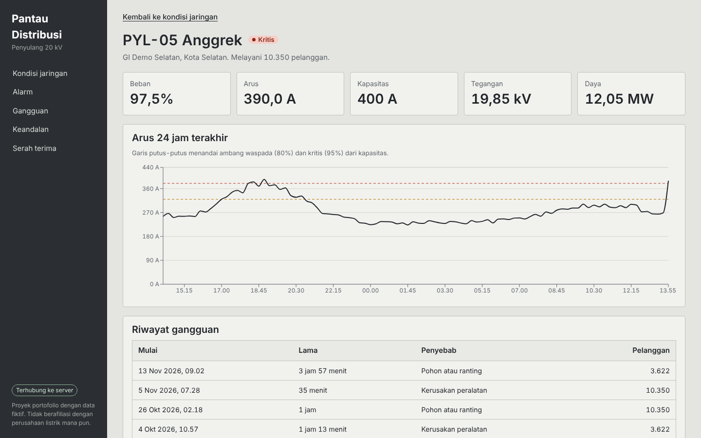
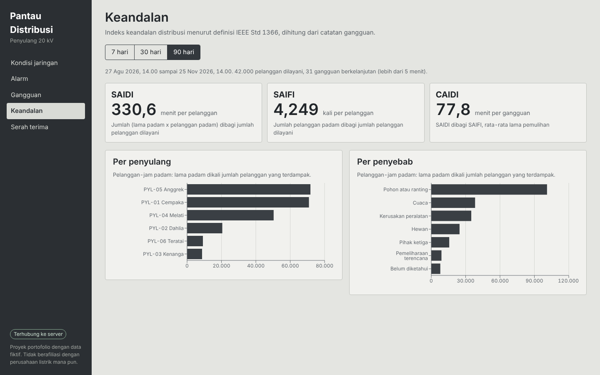
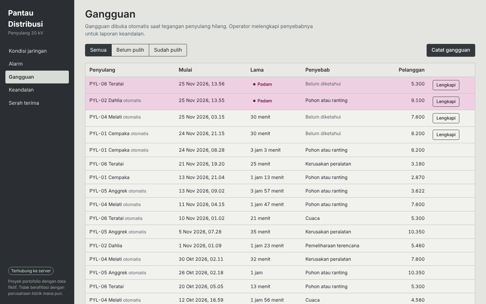
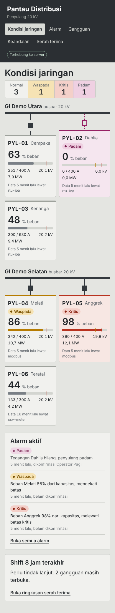

# Pantau Distribusi

Dashboard pemantauan penyulang distribusi 20 kV untuk operator ruang kendali. Sistem ini menerima telemetri dari **tiga format data yang berbeda**, menyatukannya ke satu bentuk kanonik, lalu menampilkan beban setiap penyulang, membuat alarm, mencatat gangguan secara otomatis, dan menghitung indeks keandalan **SAIDI, SAIFI, dan CAIDI**.

Backend memakai **Python (FastAPI)** dan frontend memakai **React (Vite)**.

> Proyek portofolio pribadi dengan data fiktif. Tidak berafiliasi dengan perusahaan listrik mana pun, dan bukan sistem SCADA sungguhan.

**Demo:** https://muhamadivan1.github.io/pantau-distribusi/
**Dokumentasi API interaktif:** `https://<nama-layanan>.onrender.com/docs` (lihat [PANDUAN_HOSTING.md](PANDUAN_HOSTING.md))



## Masalah yang diselesaikan

Di pusat pengatur distribusi, data beban penyulang datang dari banyak sumber: RTU di gardu induk, relai atau meter digital di penyulang, dan ekspor berkas dari sistem pembacaan meter. Setiap sumber punya struktur, satuan, dan format waktu sendiri. Akibatnya ada empat masalah:

1. **Data terpecah.** Operator harus membaca beberapa tampilan untuk tahu kondisi semua penyulang.
2. **Beban lebih terlambat diketahui.** Tanpa ambang yang jelas, penyulang yang mendekati batas kapasitas mudah terlewat.
3. **Catatan gangguan tidak lengkap.** Waktu padam, waktu pulih, dan penyebab sering dicatat terpisah, padahal ketiganya bahan utama perhitungan SAIDI dan SAIFI.
4. **Serah terima shift lisan.** Operator berikutnya bisa tidak tahu ada gangguan yang masih terbuka.

## Fitur

| Fitur | Keterangan |
|---|---|
| Integrasi multi-format | Satu endpoint `POST /api/v1/telemetry` menerima format RTU (titik ukur IOA), Modbus (register berskala, waktu epoch), dan CSV meter (desimal koma, waktu WIB). Format dikenali otomatis dari isi payload |
| Kualitas data | Validasi rentang nilai, penolakan waktu masa depan, deduplikasi dengan hash SHA-256, data susulan tidak mengacaukan status |
| Diagram busbar | Penyulang ditampilkan menggantung dari busbar gardu induknya, dengan simbol pemutus terbuka saat padam |
| Alarm bertingkat | Waspada (80% kapasitas), kritis (95%), dan padam. Operator mengonfirmasi alarm dengan namanya |
| Gangguan otomatis | Gangguan dibuka saat tegangan hilang dan ditutup saat tegangan kembali. Operator melengkapi penyebabnya |
| Indeks keandalan | SAIDI, SAIFI, CAIDI menurut definisi IEEE Std 1366, dengan rincian per penyulang dan per penyebab |
| Serah terima shift | Ringkasan kejadian dalam kalimat, disusun dengan aturan tetap dan bisa disalin ke grup operator |
| Mode demo | Frontend tetap berfungsi tanpa server, memakai cuplikan data asli dari backend |

| Detail penyulang | Keandalan |
|---|---|
|  |  |

| Gangguan | Tampilan HP |
|---|---|
|  |  |

## Teknologi

| Bagian | Teknologi |
|---|---|
| Backend | Python 3.12, FastAPI, SQLAlchemy 2, Pydantic 2, Uvicorn |
| Database | SQLite (siap diganti PostgreSQL lewat `DATABASE_URL`) |
| Frontend | React 19, Vite 8, React Router 7, Recharts 3, CSS tanpa framework |
| Pengujian | pytest (39 test), Vitest (14 test) |
| CI/CD | GitHub Actions |
| Hosting | Render (backend), GitHub Pages (frontend) |

## Menjalankan di laptop

Butuh Python 3.12 atau lebih baru dan Node.js 22.

**Backend** (terminal pertama):

```bash
cd backend
python -m venv .venv
.venv\Scripts\activate          # Windows
# source .venv/bin/activate     # macOS atau Linux
pip install -r requirements-dev.txt
uvicorn app.main:app --reload
```

Buka http://127.0.0.1:8000/docs untuk dokumentasi API. Data contoh terisi otomatis dan simulator mengirim telemetri setiap 5 detik.

**Frontend** (terminal kedua):

```bash
cd frontend
npm ci
copy .env.example .env          # Windows
# cp .env.example .env          # macOS atau Linux
npm run dev
```

Buka http://localhost:5173.

Langkah lengkap, cara mengirim telemetri sendiri, dan pemecahan masalah ada di [docs/PANDUAN_MENJALANKAN.md](docs/PANDUAN_MENJALANKAN.md).

## Menjalankan test

```bash
cd backend && pytest          # 39 test
cd frontend && npm test       # 14 test
```

## Struktur folder

```
.
├── backend/
│   ├── app/
│   │   ├── main.py            Titik masuk FastAPI, simulator mode demo
│   │   ├── config.py          Pengaturan lewat environment variable
│   │   ├── models.py          Tabel database
│   │   ├── schemas.py         Bentuk data API
│   │   ├── adapters/          Satu adapter per format telemetri + registry
│   │   ├── services/          Ingest, status, alarm dan gangguan, keandalan, ringkasan shift, simulator
│   │   └── routers/           Endpoint HTTP
│   ├── tests/                 Test pytest
│   └── tools/                 simulate.py (gateway tiruan), export_docs.py (OpenAPI dan data demo)
├── frontend/
│   └── src/
│       ├── api/               Klien live, klien demo, pemilih mode
│       ├── components/        Diagram busbar, label status, batang beban
│       ├── pages/             Enam halaman
│       └── lib/               Format waktu WIB, angka, status
├── docs/                      PRD, arsitektur, UML, BPMN, API, model data, rencana uji, panduan
├── tools/build_bpmn.py        Pembuat berkas BPMN
├── .github/workflows/         CI dan deploy GitHub Pages
├── render.yaml                Blueprint hosting backend di Render
├── PANDUAN_GITHUB.md          Urutan commit dan push
├── PANDUAN_HOSTING.md         Hosting backend dan frontend sampai online
└── CHANGELOG.md
```

## Dokumentasi

| Dokumen | Isi |
|---|---|
| [PRD](docs/PRD.md) | Latar belakang, pengguna, user story, kebutuhan fungsional dan non-fungsional |
| [Arsitektur](docs/ARCHITECTURE.md) | Komponen, alur data, pola adapter dan canonical data model, keputusan desain, keamanan |
| [UML](docs/UML.md) | Use case, class, sequence, activity, dan state diagram |
| [BPMN](docs/BPMN.md) | Penanganan gangguan, penerimaan telemetri, serah terima shift |
| [API](docs/API.md) | Semua endpoint dengan contoh request dan response, plus [openapi.json](docs/openapi.json) |
| [Model data](docs/DATA_MODEL.md) | ERD dan kamus data |
| [Rencana uji](docs/TEST_PLAN.md) | 53 test otomatis dan kasus uji manual |
| [Panduan menjalankan](docs/PANDUAN_MENJALANKAN.md) | Instalasi, simulator, mengubah pengaturan |
| [Panduan GitHub](PANDUAN_GITHUB.md) | Urutan commit dan push |
| [Panduan hosting](PANDUAN_HOSTING.md) | Render dan GitHub Pages, sampai tautan bisa dibagikan |

## Hubungan dengan tesis

Proyek ini menerapkan pola dari tesis S2 saya, Flowbeat, ke bidang lain. Di tesis, pola **Adapter dan Canonical Data Model** menyatukan data dua tensimeter yang struktur payload-nya berbeda. Di sini, pola yang sama menyatukan tiga format telemetri penyulang. Menambah sumber data baru cukup dengan satu kelas adapter tanpa mengubah logika alarm, gangguan, maupun laporan.

## Proyek pendamping: Gerbang Telemetri

Data format `modbus` di proyek ini bisa dipasok oleh [Gerbang Telemetri](https://github.com/muhamadivan1/gerbang-telemetri), gateway berbahasa Go yang membaca register IED lewat Modbus TCP sungguhan, menahan data di antrean disk saat jaringan putus, lalu mengirimnya ke `POST /api/v1/telemetry`. Saat gateway dipakai, atur `DEMO_SIMULATED_FEEDERS=PYL-01,PYL-02,PYL-03,PYL-06` supaya simulator internal tidak ikut membuat data PYL-04 dan PYL-05.

## Cara proyek ini dibuat

Kebutuhan, rancangan data, aturan status, dan skenario uji saya tentukan sendiri. Penulisan sebagian kode dibantu AI (Claude). Setiap bagian diuji dengan test otomatis dan dicoba di browser sebelum di-commit. Keputusan desain beserta alasannya dicatat di [docs/ARCHITECTURE.md](docs/ARCHITECTURE.md).

## Batasan

- API ini menerima JSON, bukan protokol industri secara langsung. Format RTU masih berupa representasi yang disederhanakan. Untuk Modbus, pembacaan protokol yang sebenarnya dilakukan oleh Gerbang Telemetri.
- Ambang 80% dan 95% adalah contoh, bukan standar perusahaan mana pun.
- Belum ada login. Endpoint telemetri dilindungi API key, sedangkan aksi operator terbuka di versi demo.
- Perhitungan keandalan belum memisahkan major event day (TMED).
- Di hosting gratis, database diisi ulang dengan data contoh setiap kali server dinyalakan ulang.

## Lisensi

[MIT](LICENSE) © 2026 Muhamad Ivan Fadilah
