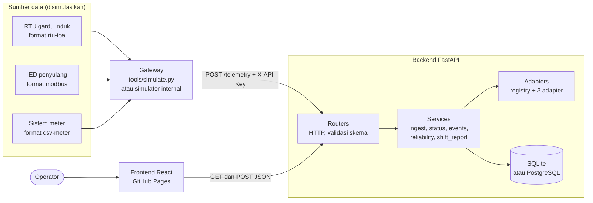
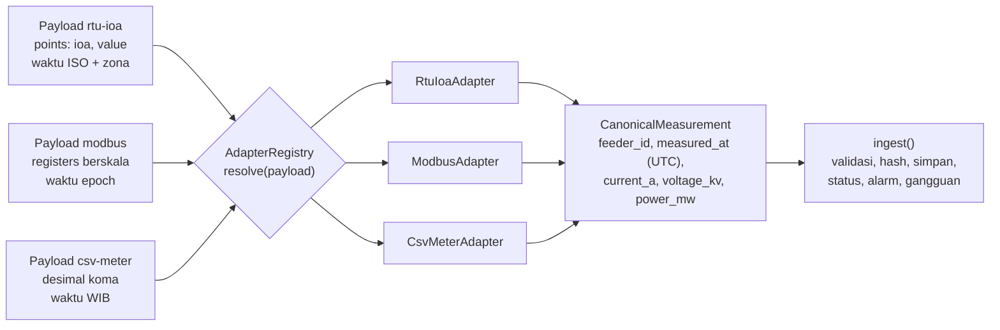
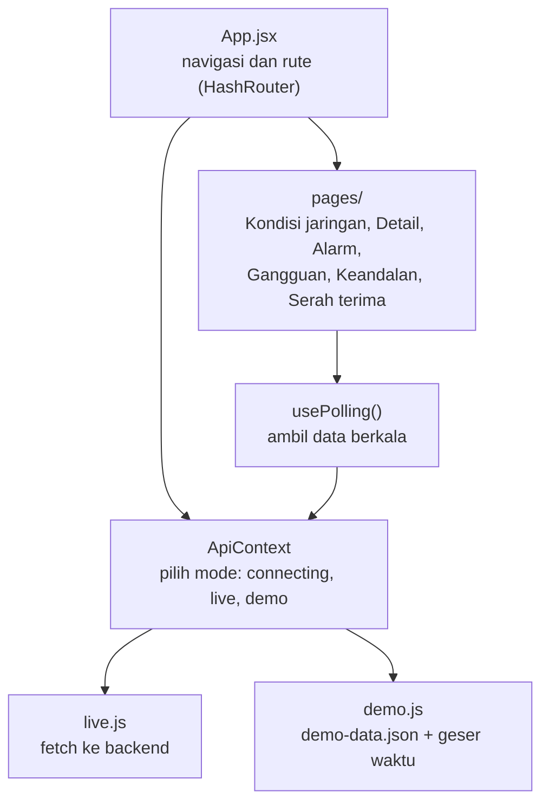
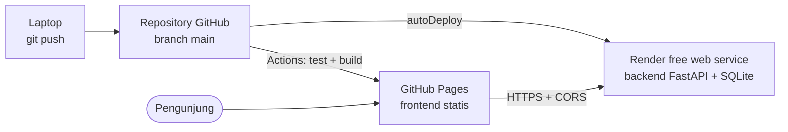

# Arsitektur Pantau Distribusi

Dokumen terkait: [UML](UML.md) untuk diagram perangkat lunak, [BPMN](BPMN.md) untuk proses bisnis, [model data](DATA_MODEL.md) untuk struktur tabel, dan [API](API.md) untuk kontrak endpoint.

## 1. Gambaran umum

Sistem terdiri dari dua aplikasi terpisah yang berkomunikasi lewat REST API berformat JSON:

- **Backend** (Python, FastAPI) menerima telemetri, menyimpan data, menentukan status, membuat alarm dan gangguan, serta menghitung laporan.
- **Frontend** (React, Vite) menampilkan data untuk operator dan mengirim aksi operator.



## 2. Lapisan backend

| Lapisan | Folder | Tanggung jawab | Tidak boleh |
|---|---|---|---|
| Router | `app/routers/` | Menerima HTTP, validasi skema dengan Pydantic, memetakan galat ke kode status | Berisi aturan bisnis |
| Service | `app/services/` | Aturan bisnis: ingest, status, alarm, gangguan, keandalan, ringkasan shift | Mengenal detail format perangkat |
| Adapter | `app/adapters/` | Menerjemahkan satu format mentah ke `CanonicalMeasurement` | Menyentuh database |
| Model | `app/models.py` | Struktur tabel (SQLAlchemy) | Berisi logika |
| Skema | `app/schemas.py` | Bentuk data masuk dan keluar API | |

Aturan ketergantungan: router memanggil service, service memanggil adapter dan model. Adapter tidak bergantung ke apa pun selain skema kanonik. Karena itu adapter bisa diuji tanpa database.

## 3. Pola Adapter dan Canonical Data Model

Ini inti arsitektur, sama seperti pada tesis Flowbeat.



Perbedaan ketiga format yang ditangani adapter:

| Dimensi | rtu-ioa | modbus | csv-meter |
|---|---|---|---|
| Struktur | Daftar titik ukur, satu payload untuk banyak penyulang | Satu objek register per penyulang | Teks CSV, banyak baris |
| Identitas penyulang | Dari peta alamat IOA | Kolom `feeder` | Kolom `penyulang` |
| Satuan nilai | Langsung (A, kV, MW) | Bilangan bulat berskala (x0,1 dan x0,01) | Desimal koma gaya Indonesia |
| Format waktu | ISO 8601 dengan zona | Epoch detik (UTC) | `dd/mm/yyyy HH:MM:SS` WIB |

Menambah format keempat: buat kelas turunan `TelemetryAdapter` dengan metode `supports()` dan `parse()`, lalu daftarkan di `default_registry`. Tidak ada perubahan di service, router, maupun frontend.

## 4. Alur ingest

1. `require_api_key` memeriksa header `X-API-Key`.
2. `registry.resolve()` memilih adapter dari isi payload. Tidak ada yang cocok berarti 422.
3. `adapter.parse()` menghasilkan daftar `CanonicalMeasurement` dan daftar rekaman yang ditolak di tahap baca.
4. Rekaman diurutkan berdasarkan waktu, lalu untuk setiap rekaman:
    1. `validate()` memeriksa penyulang terdaftar, rentang nilai, dan waktu tidak di masa depan (toleransi 5 menit).
    2. `record_hash()` membuat SHA-256 dari penyulang, waktu, dan nilai. Hash yang sudah ada dihitung sebagai duplikat.
    3. Rekaman disimpan.
    4. Jika rekaman ini paling baru untuk penyulangnya, `classify()` menentukan status dan `apply_status()` memperbarui alarm dan gangguan.
5. Semua perubahan di-commit sekaligus, lalu ringkasan hasil dikirim balik.

Data susulan (lebih lama dari data terakhir) tetap disimpan untuk grafik, tetapi tidak mengubah status. Tanpa aturan ini, data yang terlambat datang bisa membuka alarm untuk kondisi yang sudah lewat.

## 5. Aturan status, alarm, dan gangguan

| Kondisi pengukuran terakhir | Status |
|---|---|
| Tegangan < `padam_voltage_kv` (2 kV) | padam |
| Beban ≥ `threshold_kritis_pct` (95%) | kritis |
| Beban ≥ `threshold_waspada_pct` (80%) | waspada |
| Selain itu | normal |
| Belum ada pengukuran | tanpa_data |

Beban = arus terakhir dibagi kapasitas arus penyulang, dikali 100. Semua ambang ada di `app/config.py` dan bisa diganti lewat environment variable. Angka bawaan adalah contoh, bukan standar perusahaan mana pun.

Siklus alarm dan gangguan digambarkan sebagai state diagram di [UML.md](UML.md) bagian 6 dan 7.

## 6. Perhitungan keandalan

Mengikuti definisi IEEE Std 1366:

```
SAIFI = Σ Ni / NT            (kali per pelanggan)
SAIDI = Σ (ri × Ni) / NT     (menit per pelanggan)
CAIDI = SAIDI / SAIFI        (menit per gangguan)

Ni = pelanggan terdampak gangguan ke-i
ri = lama gangguan ke-i (menit)
NT = jumlah pelanggan dilayani
```

Penyederhanaan yang sengaja diambil:

| Aturan | Alasan |
|---|---|
| Hanya gangguan lebih dari 5 menit yang dihitung | IEEE Std 1366 memisahkan gangguan sesaat dari gangguan berkelanjutan |
| Gangguan yang melewati batas periode dipotong | Supaya laporan bulanan tidak menghitung menit di luar bulan itu |
| Gangguan yang belum pulih dihitung sampai sekarang | Supaya laporan berjalan tidak meremehkan dampak |
| NT = jumlah pelanggan semua penyulang saat ini | Data jumlah pelanggan historis belum disimpan |
| Belum memisahkan major event day | Butuh data harian minimal beberapa tahun untuk menghitung ambang TMED |

Kebenaran rumus diuji di `tests/test_reliability.py` dengan contoh yang bisa dihitung manual.

## 7. Frontend



Pemilihan mode:

1. `VITE_API_URL` kosong: langsung mode demo.
2. `VITE_API_URL` terisi: coba `/health` selama 8 detik. Selama itu tampil keterangan "menghubungkan".
3. Gagal: mode demo, sambil mencoba ulang setiap 20 detik sampai sekitar 3 menit.
4. Berhasil kapan pun: pindah ke mode live dan semua halaman mengambil data ulang.

Data demo bukan angka karangan. Berkas `demo-data.json` dibuat oleh `backend/tools/export_docs.py` dengan memanggil API backend asli, sehingga logika status dan keandalan yang tampil di demo sama dengan backend.

Prinsip tampilan mengikuti gaya high-performance HMI: kondisi normal berwarna abu-abu, dan warna hanya muncul untuk kondisi yang butuh perhatian (amber waspada, merah kritis, magenta padam). Status selalu disertai teks, tidak hanya warna.

## 8. Keputusan desain

| Keputusan | Alasan | Konsekuensi |
|---|---|---|
| FastAPI | Validasi dan dokumentasi OpenAPI otomatis dari tipe data, Python sudah dikuasai | Butuh server ASGI (Uvicorn) |
| SQLAlchemy dengan `DATABASE_URL` | SQLite untuk laptop dan demo, PostgreSQL untuk produksi tanpa ubah kode | Fitur khusus satu database tidak dipakai |
| Waktu disimpan UTC tanpa zona | SQLite tidak menyimpan zona waktu, UTC menghindari kebingungan WIB, WITA, WIT | API wajib menempelkan zona saat mengirim |
| Format dikenali dari isi, bukan dari parameter | Gateway tidak perlu tahu nama format, mirip content-based routing di tesis | Dua format dengan bentuk mirip butuh aturan `supports()` yang tegas |
| Satu alarm terbuka per penyulang | Menghindari banjir alarm untuk kondisi yang sama | Riwayat naik turun level tetap tercatat lewat alarm yang ditutup |
| Simulator memakai jalur ingest yang sama | Demo menguji kode produksi, bukan jalur khusus | Simulator harus menghasilkan payload yang valid |
| Ringkasan shift berbasis aturan, bukan model AI | Setiap kalimat bisa ditelusuri ke data, tidak ada risiko mengarang | Kalimatnya lebih kaku |
| React dengan CSS biasa | Tidak menambah pustaka UI, ukuran kecil, mudah dipelajari | Komponen ditulis sendiri |
| HashRouter | GitHub Pages tidak bisa mengarahkan semua alamat ke `index.html` | Alamat memakai `#/` |
| Halaman bergrafik dimuat saat dibuka (`lazy`) | Halaman awal turun dari 811 kB ke 363 kB | Ada jeda singkat saat membuka halaman grafik pertama kali |

## 9. Keamanan

| Ancaman | Penanganan |
|---|---|
| Pihak lain mengirim telemetri palsu | Header `X-API-Key`, nilai dibuat acak oleh Render dan tidak disimpan di repository |
| Payload rusak atau berbahaya | Validasi skema Pydantic, rentang nilai, penolakan per rekaman, tidak ada eksekusi isi payload |
| SQL injection | Semua query lewat SQLAlchemy dengan parameter terikat |
| XSS | Teks ditampilkan lewat React yang meng-escape otomatis, tidak ada `dangerouslySetInnerHTML` |
| Akses dari situs lain | CORS hanya mengizinkan alamat di `CORS_ORIGINS` |
| Rahasia ikut ter-push | `.env` dan berkas database ada di `.gitignore` |
| Aksi operator tanpa login | Batasan yang disadari di versi demo, direncanakan di versi 1.1 |

## 10. Deployment



Langkah lengkapnya ada di [PANDUAN_HOSTING.md](../PANDUAN_HOSTING.md).
