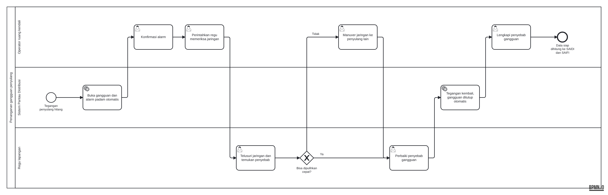
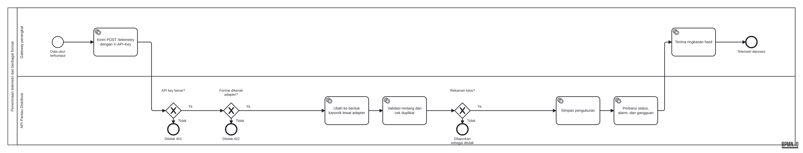
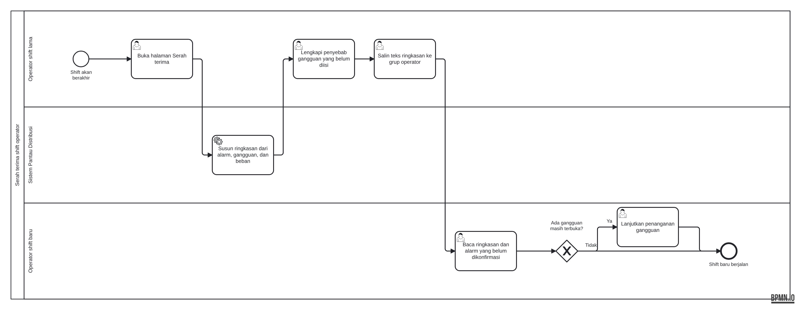

# Diagram BPMN Pantau Distribusi

Dokumen ini memodelkan tiga proses bisnis dengan notasi BPMN 2.0. Setiap proses punya dua berkas di folder `docs/bpmn/`:

| Berkas | Fungsi |
|---|---|
| `.bpmn` | Berkas BPMN 2.0 asli. Bisa dibuka dan diedit di [demo.bpmn.io](https://demo.bpmn.io) atau Camunda Modeler |
| `.png` | Gambar untuk dibaca langsung di GitHub |

Berkas `.bpmn` dibuat oleh `tools/build_bpmn.py`. Untuk mengubah proses, ubah data di skrip itu lalu jalankan `python tools/build_bpmn.py` dari folder utama. Setelah itu buka berkas `.bpmn` di demo.bpmn.io dan ekspor ulang gambarnya.

Ketiga proses adalah gambaran umum kerja ruang kendali distribusi untuk keperluan portofolio, bukan prosedur resmi perusahaan mana pun.

## Notasi

| Simbol | Nama | Arti di diagram ini |
|---|---|---|
| Lingkaran tipis | Start event | Awal proses |
| Lingkaran tebal | End event | Akhir proses |
| Kotak dengan ikon orang | User task | Dikerjakan manusia |
| Kotak dengan ikon roda gigi | Service task | Dikerjakan sistem |
| Belah ketupat dengan X | Exclusive gateway | Percabangan, hanya satu jalur yang dipilih |
| Pool dan lane | Kolam dan lajur | Siapa yang menjalankan langkah itu |

## 1. Penanganan gangguan penyulang

Proses ini menunjukkan peran sistem dalam alur kerja operator: sistem mencatat waktu padam dan pulih secara otomatis, sedangkan manusia menangani keputusan di lapangan dan melengkapi penyebab.

| Langkah | Pelaku | Didukung fitur |
|---|---|---|
| Buka gangguan dan alarm padam otomatis | Sistem | `apply_status()` saat tegangan di bawah 2 kV |
| Konfirmasi alarm | Operator | Halaman Alarm, `POST /alarms/{id}/acknowledge` |
| Perintahkan regu memeriksa jaringan | Operator | Di luar sistem (radio, telepon) |
| Bisa dipulihkan cepat? | Regu lapangan | Keputusan lapangan |
| Manuver jaringan ke penyulang lain | Operator | Di luar sistem. Jumlah pelanggan terdampak bisa dikoreksi lewat `PATCH /outages/{id}` |
| Tegangan kembali, gangguan ditutup otomatis | Sistem | `apply_status()` saat status bukan padam |
| Lengkapi penyebab gangguan | Operator | Halaman Gangguan, tombol Lengkapi |

## 2. Penerimaan telemetri dari berbagai format

Proses ini adalah alur teknis di dalam backend. Ketiga titik penolakan dilaporkan dengan jelas, sehingga gateway tahu apa yang harus diperbaiki.

| Titik keputusan | Jika tidak lolos | Kode |
|---|---|---|
| API key benar? | Seluruh permintaan ditolak | 401 |
| Format dikenali adapter? | Seluruh permintaan ditolak, disertai daftar format yang didukung | 422 |
| Rekaman lolos? | Hanya rekaman itu yang ditolak, rekaman lain tetap disimpan | 201 dengan isian `rejected` |

## 3. Serah terima shift operator

Proses ini memastikan gangguan yang masih terbuka dan alarm yang belum dikonfirmasi tidak hilang saat pergantian operator.

| Langkah | Pelaku | Didukung fitur |
|---|---|---|
| Susun ringkasan dari alarm, gangguan, dan beban | Sistem | `GET /reports/shift-summary` |
| Lengkapi penyebab gangguan yang belum diisi | Operator lama | Halaman Gangguan |
| Salin teks ringkasan ke grup operator | Operator lama | Tombol Salin teks |
| Baca ringkasan dan alarm yang belum dikonfirmasi | Operator baru | Halaman Serah terima dan Alarm |
