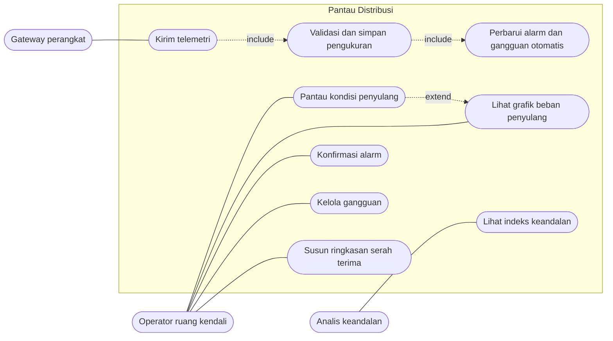
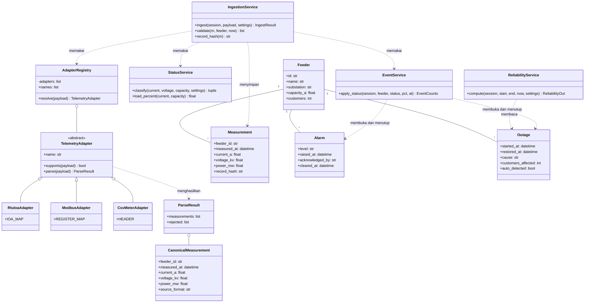
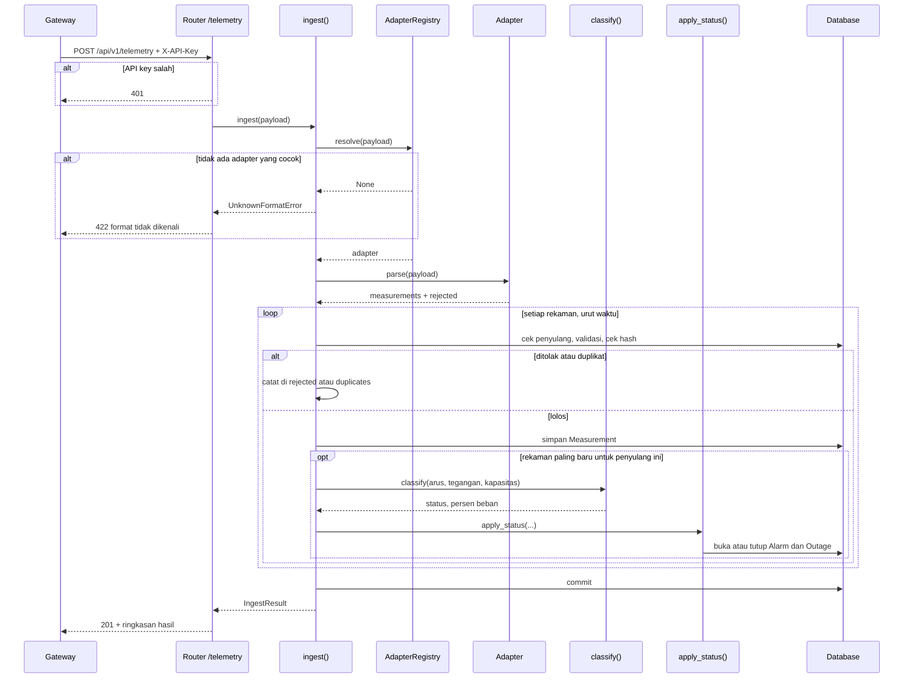
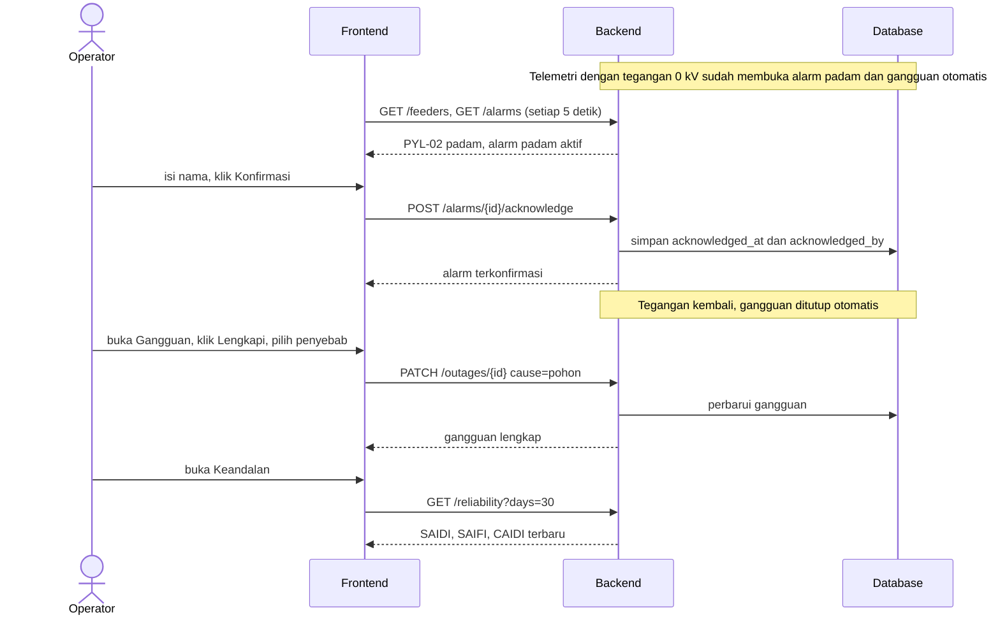
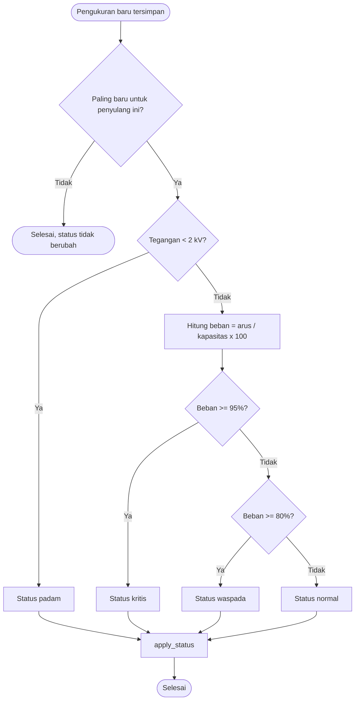
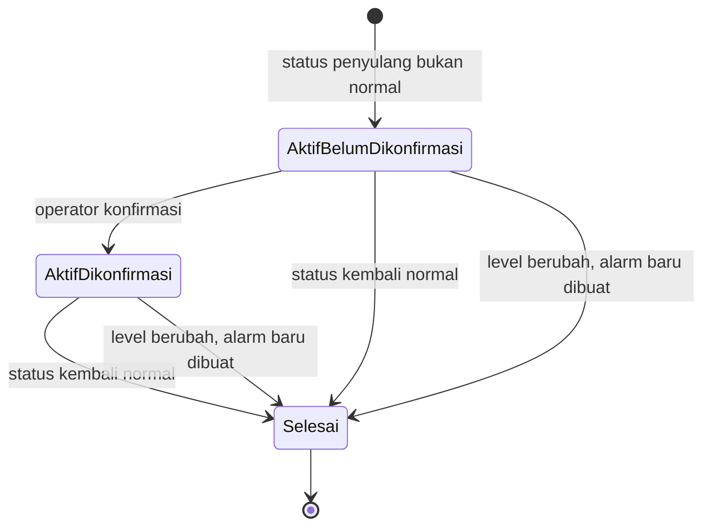
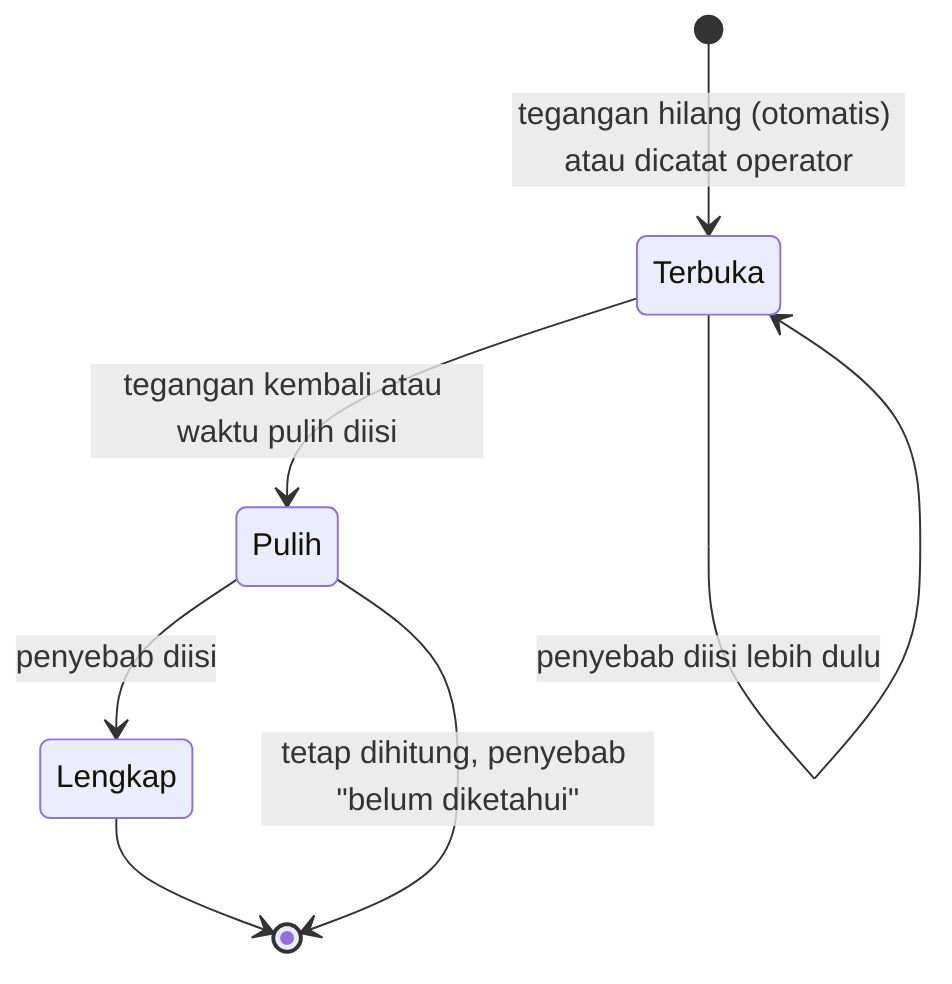
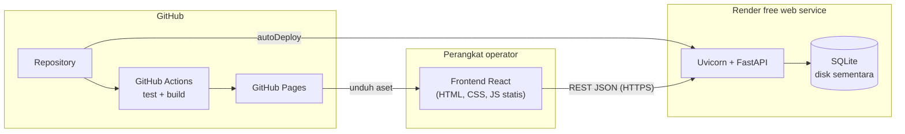

# Diagram UML Pantau Distribusi

Semua diagram ditulis dengan [Mermaid](https://mermaid.js.org) sehingga langsung tampil di GitHub dan mudah diubah.

## 1. Use Case Diagram

## 2. Class Diagram

Kelas utama di lapisan adapter, service, dan data.

## 3. Sequence Diagram: ingest telemetri

## 4. Sequence Diagram: operator menangani gangguan

## 5. Activity Diagram: menentukan status penyulang

## 6. State Diagram: alarm

## 7. State Diagram: gangguan

## 8. Deployment Diagram

